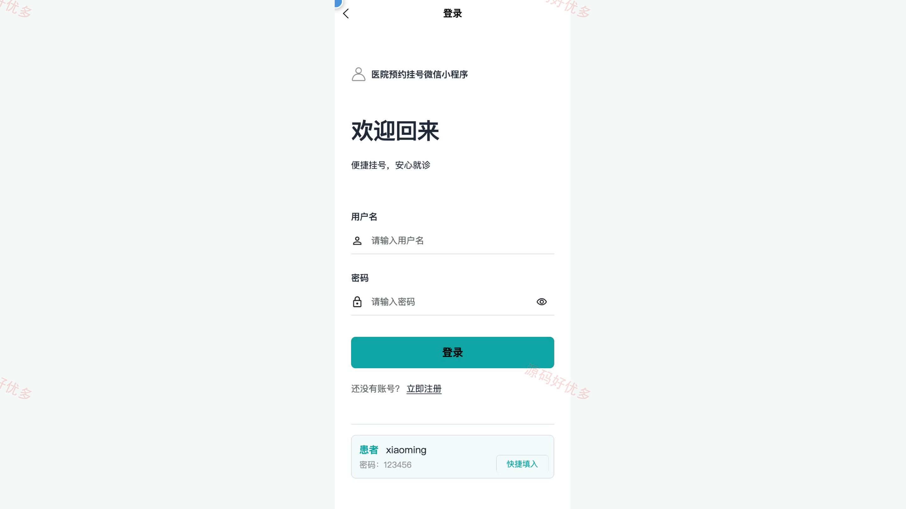
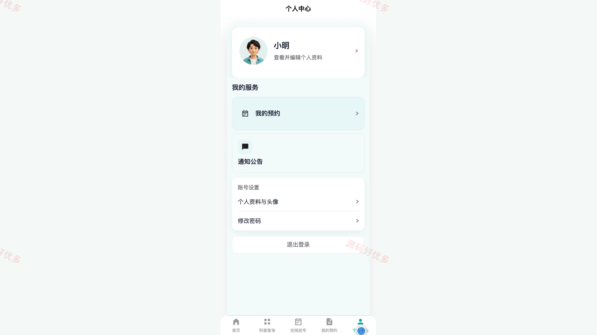
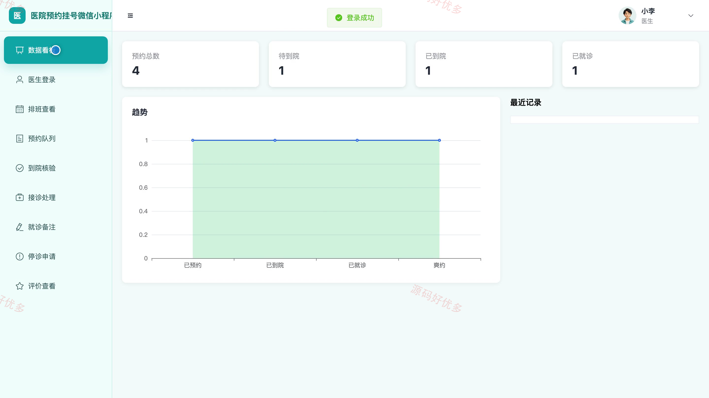
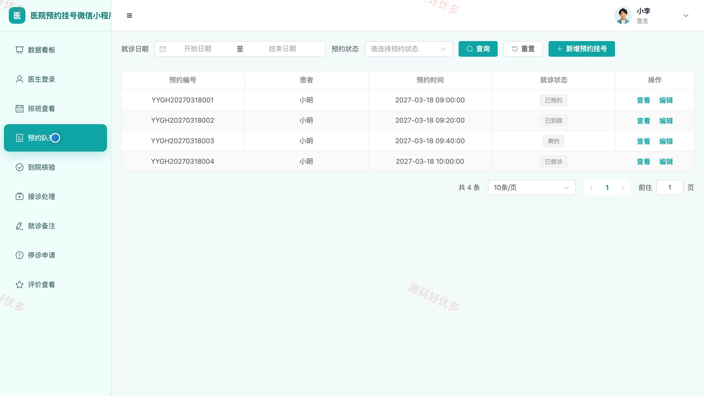
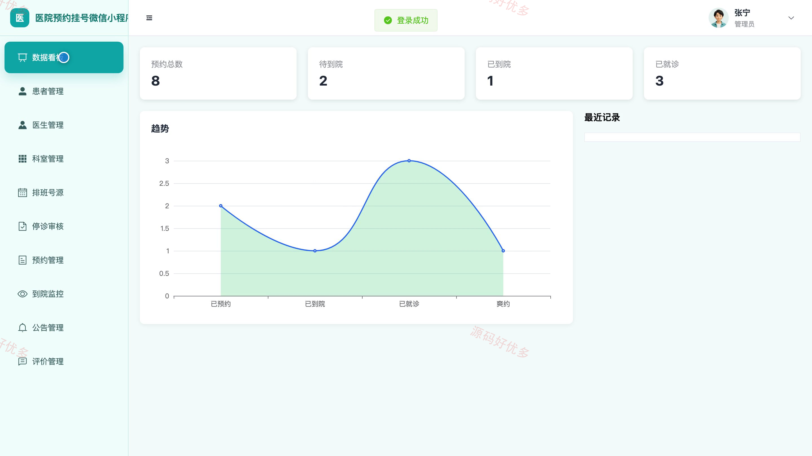

# bs007B
bs007B医院预约挂号微信小程序源码 Java SpringBoot3 Vue3 文档 PPT
## 源码问题查看主页咨询

### 一、关键词
医院预约挂号、门诊预约、分时挂号、医生排班、就诊管理

### 二、作品包含
源码+数据库+万字设计文档+PPT+全套环境和工具资源+本地部署教程

### 三、项目技术
前端技术： Html、Css、Js、Vue3.4、Element-Plus、uniapp
后端技术：Java、SpringBoot3.2.0、MyBatis-Plus

### 四、运行环境要求
开发工具：IDEA/eclipse + VSCODE + HBuilder X + 微信开发者工具

数据库：MySQL5.7+（共11张表）

数据库管理工具：Navicat10以上版本

环境配置软件： JDK17 + Maven3.6

前端Nodejs：16+

浏览器：谷歌浏览器

### 五、项目介绍
项目编号：bs007B

医院预约挂号微信小程序面向患者、医生和管理员，围绕科室医生查询、分时号源预约、到院核验、接诊备注、停诊审核与就诊评价，形成从预约到就诊反馈的业务闭环。

角色：患者、医生、管理员

患者功能：账号注册与登录、科室与医生排班查询、在线挂号、预约记录查看与取消、预约详情与凭证查看、医院公告查看、就诊评价、个人资料与密码维护。

医生功能：排班号源查看、预约队列查询、到院核验、接诊状态处理、就诊备注维护、停诊申请、就诊评价查看、预约数据统计。

管理员功能：预约数据看板、患者账号管理、医生资料管理、医院科室管理、排班号源管理、停诊申请审核、预约与到院管理、公告与评价管理。

### 六、运行截图

